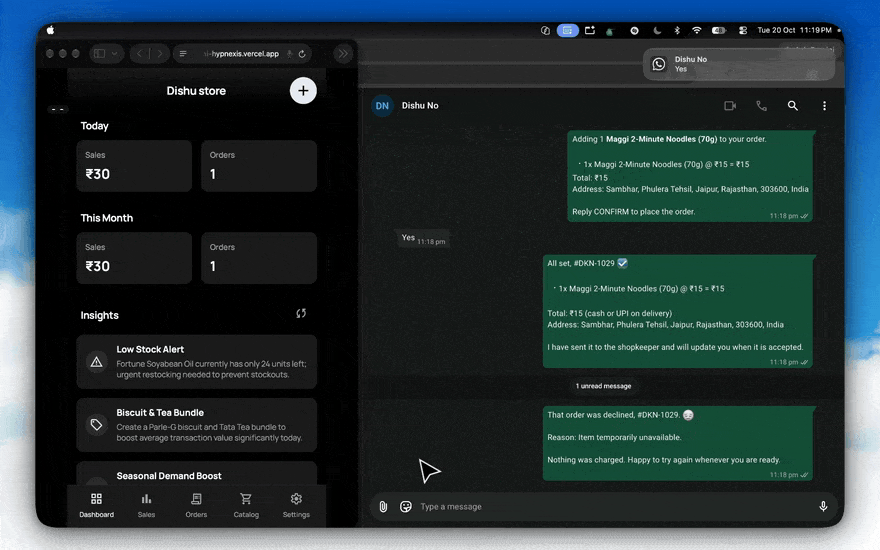
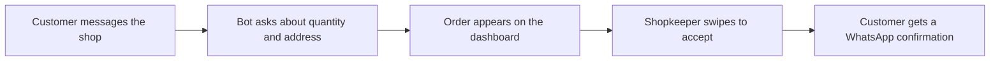

<!-- prettier-ignore -->
<div align="center">


# Dukaan.AI

**The shop around the corner, now taking orders on WhatsApp.**

[](https://react.dev/)
[](https://nodejs.org/)
[](#what-it-does)
[](#the-live-beta)

[Try the beta](https://dukaan-ai-hypnexis.vercel.app) · [How it works](#how-it-works) · [Run it locally](#run-it-locally) · [Configuration](#configuration)

</div>

<div align="center">



<sub>One order, start to finish. WhatsApp on the right, the shop dashboard on the left.</sub>

</div>

## Why this exists

Blinkit, Zepto and Instamart keep opening dark stores inside Indian neighbourhoods. A family kirana cannot beat them on ten minute delivery or on price. It does not need to: it stands a few hundred metres from the customer, and that customer has trusted it for twenty years.

What the shop lacks is a way to take an order online. An app of its own costs too much to build, and customers do not want one. Nobody installs a 100 MB app to order milk.

WhatsApp is already on more than 500 million Indian phones. So that is where the shop lives.

## How it works



## What it does

The customer sends a message by text or voice note in whatever language they speak. The bot asks about quantity when something is unclear, then writes the order down properly.

Inside the shop, a screen chimes and shows the new order. The shopkeeper swipes to accept and the customer gets a confirmation on WhatsApp without anyone typing one. Orders are confirmed in under 15 minutes, which is the point when milk is needed right now.

The shopkeeper gets a live dashboard, a starter catalog for a kirana, stock that can be switched off with one tap, and sales numbers without a spreadsheet. When something runs low the app highlights it and drafts a reorder message for the distributor. The bill photo button works too: send a photo of the bill and the stock updates.

The screen and the bot both work in English, Hindi, Tamil, Punjabi, Kannada, Gujarati and Urdu.

## The live beta

The beta runs at https://dukaan-ai-hypnexis.vercel.app. The older https://dukaan-ai-beta.vercel.app address redirects there. Open it on a phone or a laptop, sign in with an email or as a guest, and link your WhatsApp number from Settings. Nothing to download, for you or for your customer.

A beta caveat: the bot runs on one laptop at home, behind a tunnel, so it goes quiet when that machine sleeps. The AI still misreads a messy message now and then, and voice notes can take a few seconds to come back. If something breaks, tell us and we will fix it.

We want to hear whether an order came through right, whether the bot understood what you typed, and whether the dashboard made sense the first time you saw it.

## Run it locally

### What you need

- Node.js 20 or higher
- Git
- A phone with WhatsApp on it
- An OpenRouter API key if you want the AI ordering to work (get one at https://openrouter.ai/keys)

### 1. Clone the repo

```bash
git clone https://github.com/dishudhalwal12/dukaan.ai.git
cd dukaan.ai
```

### 2. Fill in the environment

There is one environment file for the whole app, and every key it accepts is explained in the template:

```bash
cp .env.example .env
```

Open `.env` and add your keys. At a minimum, put your `OPENROUTER_API_KEY` in for the AI ordering. The files under `whatsapp/` are only signposts; the bot reads the root `.env`, so you never copy it twice.

### 3. Start the two services

The bot and the web app run as two small processes.

```bash
# Terminal 1: the bot, on port 5001
cd whatsapp
npm install
npm start
```

```bash
# Terminal 2: the dashboard, on port 3000
npm install
npm run dev
```

> [!IMPORTANT]
> The bot has to keep running on port 5001. In development, Vite sends `/api` and `/events` from `http://localhost:3000` straight to `http://localhost:5001` for you.

### 4. Link your WhatsApp

1. Open http://localhost:3000 in a browser.
2. Go to Settings and open WhatsApp Settings. The terminal running the bot also prints a QR code.
3. On the phone, open WhatsApp, then Linked Devices, then Link a Device.
4. Scan the code.
5. Message the linked number from another phone and the order should land on the dashboard.

## Tests

Both halves have tests. They are plain Node scripts, so there is no test runner to install.

```bash
npm test                    # frontend and repo checks
cd whatsapp && npm test     # bot checks
```

The frontend set covers order status, polling, order ownership, cloud rows, the AI fallback gate, API auth, and that no key reached the bundle. The bot set covers the store, the catalog, the prompt scope, message capture, auth, CORS, the AI proxy, and a full pipeline run from a WhatsApp message to a dashboard order.

```bash
npm run stress                                        # ramp the pipeline
cd whatsapp && npm run test:reliability                # 1400 cases through the pipeline
npm run terminal-chat                                  # chat with the bot from a terminal, no WhatsApp needed
cd whatsapp && npm run export:training                 # see the ledger section below
```

`npm run build` also runs `scripts/check-secrets.mjs` afterwards. If a secret ever reaches `dist/`, the build fails instead of shipping it.

## Configuration

Every key lives in the root `.env`. The complete list with the reasoning for each one is in `.env.example`, and the table below is the short version.

| Variable | Default | What it does |
| :--- | :--- | :--- |
| `VITE_SUPABASE_URL` | empty | Supabase project URL. Turns on sign in and cloud sync. Empty means guest mode and local storage only. |
| `VITE_SUPABASE_ANON_KEY` | empty | The anon (publishable) key. Safe to ship only because Row Level Security is on for every table. |
| `VITE_API_BASE` | empty | Origin the browser calls for `/api` and `/events`. Leave it empty when the bot serves the site itself. On Vercel, point it at the public backend URL. |
| `VITE_SUPPORT_WHATSAPP` | empty | Support number with country code, for example `919876543210`. Empty hides the Call Us button. |
| `SUPABASE_URL` | empty | The same project URL, read by the bot. |
| `SUPABASE_SERVICE_KEY` | empty | Service role key. The bot uses it to read the shop list, mirror orders, and check a shopkeeper's access token. |
| `SUPABASE_SERVICE_ROLE_KEY` | empty | The same key under the name some dashboards use. Read only when the line above is empty. |
| `OPENROUTER_API_KEY` | empty | Key the bot calls models with. The browser never sees it. |
| `OPENROUTER_MODEL` | `meta-llama/llama-3.1-8b-instruct` | The model to ask for. A server decision, so nobody can request a model the shop cannot afford. |
| `AI_MODEL_FALLBACKS` | empty | Tried in order when the model above fails. At most three, and at least one must accept images or the bill photo button fails every time. |
| `AI_DATA_COLLECTION` | `deny` | `deny` keeps shop data out of provider training but rules out free models. A `:free` model needs `allow`. |
| `GROQ_API_KEY` | empty | Fast voice note transcription. |
| `GROQ_MODEL` | empty | The model used for that transcription. |
| `LLM_BASE_URL`, `LLM_MODEL_NAME` | empty | Optional local OpenAI compatible model, server side only. Uncomment only if one is actually running. |
| `OPERATOR_USER_IDS` | empty | Comma separated Supabase user ids allowed to reach operator routes. Empty means nobody, and those routes answer 403. |
| `CORS_ORIGINS` | empty | Browser origins allowed to call the API. The Vercel app and the tunnel domain belong here. |
| `ENABLE_OPS_CONSOLE` | off | The older console at `/ops`. It can re-pair the WhatsApp session, so it is on only when the value is exactly `1`. |
| `PORT` | `5001` | Port the bot listens on. |
| `AUTH_DIR` | `./auth_info` | Where the WhatsApp session is kept, resolved against `whatsapp/`. Do not prefix it with `whatsapp/` or the bot starts with no session and every shop has to scan again. |
| `DUKAN_MAX_DELIVERY_KM` | `5` | A shop farther than this from the customer's pin does not serve them. |
| `DUKAN_ORDERS_FILE`, `DUKAN_CATALOG_FILE` | `./whatsapp/...` | Where the order and catalog files live. |
| `DUKAN_DEFAULT_OWNER_ID` | empty | Used only when Supabase is not configured. Without it, and without a service key, the bot refuses every order rather than writing one with no owner. |
| `N8N_WEBHOOK_URL` | empty | Webhook the bot posts order events to. The ops console writes it back into `.env`. |

> [!WARNING]
> Every `VITE_*` variable ends up inside the browser bundle, where anyone can read it. Never put a Supabase `service_role` key, a database password, or any private credential in a `VITE_*` variable.

### Where the language preference lives

The chosen language is kept in two places on purpose. `localStorage` under `dukan-language` is what the app reads first, so switching language is instant and works with no network. `merchant_preferences.preferred_language` is the copy that survives a reinstall, a cleared browser or a new phone.

A choice made on a device always wins over the stored value, which is why `dukan-language-chosen` exists. Without it there is no way to tell "never chose, so English" apart from "chose English on purpose", and signing in would silently undo a deliberate choice. The stored value only fills the gap on a device that has not chosen yet. Logging out keeps the language and forgets the "chosen" marker, so the next account on that phone adopts its own saved language.

### Email confirmation links

When **Confirm email** is on, signup sends a link that has to confirm the account **wherever it is opened**, whether that is a mail app's browser, Chrome, or a different device. That takes a dashboard setting, one migration and one deploy; none of it lives in repo config:

1. Supabase dashboard → **Authentication → URL Configuration**.
2. **Site URL** → the production app URL (e.g. `https://<app>.vercel.app`).
3. **Redirect URLs** → allowlist the app origin and the dev server, so the `emailRedirectTo` the app sends (`window.location.origin + pathname`) is allowed:
   - `https://<app>.vercel.app/**`
   - `http://localhost:3000/**`
4. **Authentication → Email Templates → Confirm signup** → replace the link with `https://<app>.vercel.app/?token_hash={{ .TokenHash }}&type=signup`.

   The link must be **root-relative**: Vercel serves `dist/` as flat files, so only `/` maps to `index.html` and any other path 404s before the app loads. Vite's dev server hides this by serving an SPA fallback for every path, which is why `scripts/test_repo_hygiene.js` asserts the documented link stays at the root rather than trusting a local check.
5. Apply `supabase/email_confirmation.sql` (SQL editor). It creates the `is_email_confirmed` function the status endpoint calls.
6. `supabase functions deploy email-confirmation-status`.

Step 4 is the one that makes the link work anywhere. The app verifies `token_hash` with `verifyOtp`, which needs no PKCE `code_verifier`. The default `{{ .ConfirmationURL }}` does need one, and that verifier lives in the browser that started the signup, so a link opened in Gmail's browser could never sign that account in.

With steps 4 to 6 in place the confirmation page confirms in whatever browser opened it, and the "Check your email" panel polls the status endpoint every 3 seconds. A confirmation on one device finishes the sign-in on every device, with no manual refresh and no second tap.

The landing page never refreshes, redirects or opens a second tab. It used to offer an "Open in Chrome" hand-off for mail-app browsers, but that re-opened the same one-time link in another tab: the token was spent twice and the second tab painted "This link didn't work" over a confirmation that had actually succeeded. The link is also wiped out of the address bar the instant it is read, before the network round trip, so the one-time `token_hash` is not left on screen.

One part of the Google/consent experience is not in this repo: what the Google account chooser itself shows. Set **Authentication → Providers → Google** in Supabase, and the OAuth consent screen in Google Cloud (app name, support email, homepage and privacy-policy URL, using the production URL such as `https://<app>.vercel.app`). The in-app half lives in `AuthModal`.

`emailRedirectTo` is still sent on signup and resend. Before step 4 it is what decides where the confirmation link lands; after step 4 it no longer affects confirmation. Skip step 3 and Supabase ignores `emailRedirectTo`, falls back to the Site URL, and the link opens the wrong page.

## Deploying

The web app is a static build, so it can live on Vercel. The bot has to run on a machine that stays awake, because it holds the WhatsApp session, and `VITE_API_BASE` points the browser at it.

Everything about deploying is in [deploy/README.md](deploy/README.md): the production topology, day-2 operations, the security contract, and `./deploy/laptop/update.sh`, which builds, syncs, restarts, verifies, and puts the previous version back if a check fails.

## Project structure

```
dukaan.ai/
├── index.html                   # Vite entry document
├── vite.config.ts               # Dev server (3000) + /api & /events proxy -> 5001
├── tsconfig.json                # TypeScript config (scopes src/ + vite.config.ts)
├── package.json                 # Frontend dependencies & scripts
├── supabase/
│   ├── schema.sql               # Tables + Row Level Security policies (fresh installs)
│   ├── email_confirmation.sql   # RPC behind the confirmation status endpoint
│   ├── fix_signup.sql           # Repair script for older signup rows
│   ├── migrations/              # Idempotent, non-destructive migrations (date order)
│   └── functions/               # Edge Functions (capture-session, email-confirmation-status)
├── .env.example                 # The one environment template for the whole app
├── docs/
│   └── demo.gif                 # Demo shown at the top of this file
├── public/                      # Static assets served as-is
│   ├── logo.png                 # App mark (favicon, PWA, social card source)
│   ├── favicon.ico
│   ├── apple-touch-icon.png
│   ├── og-image.png             # 1200x630 card for X/Open Graph
│   ├── banner.mp4               # Settings cover video
│   ├── site.webmanifest
│   ├── index.css
│   └── i18n/locales/            # Translation bundles (en, hi, gu, kn, pa, ta, ur)
├── src/                         # Shopkeeper POS (React 19 + TypeScript)
│   ├── index.tsx                # ReactDOM entry
│   ├── App.tsx                  # Root view, routing & live SSE order listener
│   ├── types.ts                 # Shared domain types
│   ├── supabase.ts              # Supabase client + isSupabaseConfigured()
│   ├── vite-env.d.ts            # Vite client types
│   ├── components/              # AuthModal, NewOrderModal, ProductModal, Toast, ...
│   ├── contexts/                # LanguageContext, ProductContext
│   ├── data/                    # Kirana presets (businessPresets, presetProducts, ...)
│   ├── hooks/                   # useBusinessLabel
│   ├── screens/                 # Dashboard, Catalog, Orders, Sales, Insights,
│   │                            # Onboarding, Settings + settings/ sub-screens
│   ├── services/                # auth, cloudSync, ai, whatsappService, uploadService
│   └── utils/                   # openrouterClient, audioAlert, parsers, sanitize,
│                                # phone, image, tabResolver, geminiClient
├── whatsapp/                    # WhatsApp Baileys engine (Node + Express, :5001)
│   ├── server.js                # Express server & SSE event broadcaster
│   ├── dukanBot.js              # Conversation handler & cart parser
│   ├── dukanCatalog.js          # Store catalog synchronization
│   ├── dukanOrders.js           # Live order ledger & status management
│   ├── dukanShops.js            # Shop registry
│   ├── store.js                 # JSON state persistence layer
│   ├── audioTranscriber.js      # Voice message transcription
│   ├── locationFetcher.js       # Location pin coordinate resolver
│   ├── export_training_data.js  # The only filter between the ledger and training data
│   ├── public/                  # QR pairing / status web UI
│   ├── store/                   # Runtime state (catalog, orders, chats, messages)
│   └── test_*.js                # Engine + trigger-gate tests
├── scripts/                     # Repo-side tooling & tests
│   ├── local-ai/                # LoRA dataset generation & local model serving
│   ├── check-secrets.mjs        # Fails the build if a secret reaches dist/
│   ├── seed_300_catalog.js
│   ├── terminal_chat.js
│   └── test_*.js
├── deploy/                      # Production runbook, deploy and hardening scripts
│   ├── README.md                # Current topology + day-2 operations
│   ├── laptop/                  # update.sh, harden.sh, reconnect.sh, migrate-env.sh
│   └── wispbyte/                # Legacy VPS startup script (not in the live path)
└── .claude/
    └── context.md               # Engineering context, incident log and runbook
```

## The message ledger and the training export

The bot shares the shopkeeper's own WhatsApp number, so the ledger (`whatsapp/store/messages.json`) holds two very different kinds of chat: real customer orders, and the owner's personal messages.

Capture keeps everything on purpose. `whatsapp/server.js` writes every message to the ledger, tagged with a source of `customer`, `human`, or `bot`. Nothing is dropped at capture time, so a mistake in the filter can never lose history.

Filtering happens at export instead. `whatsapp/export_training_data.js` is the only filter. A training session opens on the `/hey` trigger and closes on the bot's order confirmation reply, and everything outside that window counts as personal and stays out:

```bash
node whatsapp/export_training_data.js --report        # who is personal, who is a session
node whatsapp/export_training_data.js --out train.jsonl
```

The trigger is `/hey` with the leading slash, not a bare "hey" and not "/heyy".

The live ledger lives on the bot's machine, not in a dev checkout. `whatsapp/store/` is gitignored and excluded from the deploy sync, so the running bot keeps its own copy. To export real data, run the exporter on that machine, or copy `messages.json` across and pass `--in <path>`.

The ledger is also written atomically. `store.js` writes through a temp file and renames it into place, so a restart or a crash in the middle of a write cannot truncate the file and wipe the history.
