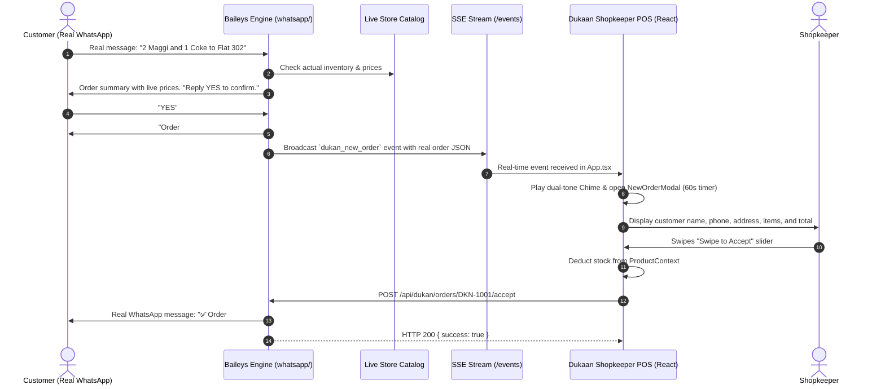

# Production WhatsApp (Baileys) AI Ordering & Swipe-to-Accept POS Integration Plan

> **For agentic workers:** REQUIRED SUB-SKILL: Use `superpowers:subagent-driven-development` (recommended) or `superpowers:executing-plans` to implement this plan task-by-task. Steps use checkbox (`- [ ]`) syntax for tracking.

**Goal:** Integrate the local Baileys WhatsApp engine (`whatsapp/`) directly with the Dukaan.ai POS for **100% real production operation**—zero mock data, no test simulator buttons, and no simulated orders. Customers message the store's real WhatsApp number, the bot queries the store's live catalog, the customer confirms the order, the real order packet streams instantly into the shopkeeper POS via Server-Sent Events with an audio chime and pop-up modal, and the shopkeeper swiping to accept dispatches a real WhatsApp confirmation message back to the customer.

**Architecture:** A real-time, event-driven production architecture connecting the Node.js/Baileys WhatsApp service (`PORT=5001`) with the Dukaan.ai React POS (`PORT=3000`). The shopkeeper links their actual WhatsApp device via live QR code or phone pairing code. When a customer confirms an order on WhatsApp (via OpenRouter AI or catalog rule engine), the Baileys engine creates a real pending order and broadcasts a `dukan_new_order` event via Server-Sent Events (SSE). The Dukaan app receives the real packet, plays a dual-tone chime, and displays `NewOrderModal`. When the shopkeeper swipes right to accept, the app calls `POST /api/dukan/orders/:id/accept`, prompting Baileys to send a real WhatsApp confirmation message to the customer's phone and automatically decrementing store inventory.

**Tech Stack:**
- **Frontend:** React 19, TypeScript, Vite, Tailwind CSS, Web Audio API, Server-Sent Events (`EventSource`).
- **Backend / WhatsApp Engine:** Node.js, Express, `@whiskeysockets/baileys` (v7.0), OpenRouter AI API (`liquid/lfm-2.5-2.6b:free` or `openrouter/free`), Whisper audio transcriber, Nominatim location reverse-geocoder.

---

## Global Constraints

- **Strictly Real Data:** No mock data, no mock customer generators, no test simulator buttons, and no fake fallbacks in UI or backend.
- **No Server Execution During Planning:** Do not start or run daemon servers during the planning phase.
- **Port Separation:** WhatsApp backend runs on `PORT=5001` (to prevent collision with Vite on `PORT=3000`).
- **Proxy Configuration:** Vite proxies `/api` and `/events` directly to `http://localhost:5001`.
- **Live Catalog Source of Truth:** WhatsApp bot uses the store's actual live catalog synced from the Dukaan POS (real prices, real stock availability).
- **Clean Audio Alert:** Web Audio API synthesis (880Hz -> 659.25Hz chime) requiring zero external media assets.
- **Production Error Handling:** Explicit HTTP error logging and resilient SSE auto-reconnect without synthetic fallback data.

---

## System Architecture & End-to-End Workflow



---

## User Review Required

> [!IMPORTANT]
> **1. Elimination of Mock & Test Elements:**
> All test order buttons, simulator controls, and fake customer generators are completely excluded. The system interacts only with live WhatsApp messages and the shopkeeper's real product catalog.

> [!NOTE]
> **2. Port Configuration (`5001` vs `3000`):**
> Vite runs on `PORT=3000`. The Baileys WhatsApp backend will run on `PORT=5001`. Vite proxies `/api` and `/events` directly to `http://localhost:5001` with zero CORS issues.

> [!TIP]
> **3. Real Device Linking Flow:**
> The shopkeeper links their actual business WhatsApp account directly inside Dukaan under **Settings > WhatsApp Store** by scanning the live QR code or requesting an 8-digit phone pairing code. Credentials persist in `./whatsapp/auth_info` across restarts.

---

## Proposed Changes

```
dukaan.ai/
├── whatsapp/
│   ├── .env                      # [MODIFY] Set PORT=5001
│   ├── server.js                 # [MODIFY] Add catalog sync route, remove test-order endpoint, port 5001
│   ├── dukanBot.js               # [MODIFY] Use live catalog, refine confirmation message
│   └── dukanCatalog.js           # [MODIFY] Support bulk sync from shopkeeper POS
├── vite.config.ts                # [MODIFY] Proxy /api and /events to port 5001
├── types.ts                      # [MODIFY] Add customerJid to Order interface
├── utils/
│   └── audioAlert.ts             # [NEW] Web Audio API dual-tone chime generator
├── services/
│   └── whatsappService.ts        # [NEW] Production REST & SSE client (status, QR, pairing, accept, reject, sync)
├── screens/
│   ├── settings/
│   │   └── WhatsAppSettingsScreen.tsx # [NEW] Real device pairing (QR & phone code), live status, disconnect
│   └── SettingsScreen.tsx        # [MODIFY] Register WhatsApp Store settings item
├── contexts/
│   └── ProductContext.tsx        # [MODIFY] Auto-sync store products to Baileys catalog
└── App.tsx                       # [MODIFY] Real-time SSE listener, chime, swipe-to-accept WhatsApp dispatch
```

---

### Component 1: WhatsApp Engine (`whatsapp/`)

#### [MODIFY] `whatsapp/.env`
- Set `PORT=5001` for production backend.
```env
PORT=5001
N8N_WEBHOOK_URL=
AUTH_DIR=./auth_info
OPENROUTER_API_KEY=
OPENROUTER_MODEL=liquid/lfm-2.5-2.6b:free
```

#### [MODIFY] `whatsapp/server.js`
- Change fallback port to `5001`: `const PORT = process.env.PORT || 5001;`.
- Remove `/api/dukan/orders/test-order` (no mock data endpoints).
- Add endpoint `POST /api/dukan/catalog/sync` to bulk-sync the shopkeeper's real products from Dukaan into `dukanCatalog`.
- In `POST /api/dukan/orders/:id/accept`, send the real WhatsApp acceptance message to `order.customerJid`:
  ```js
  const notifyText = `✅ *Order Accepted by Dukan! (Order #${order.id})*\n\nThe shopkeeper has accepted your order and is packing it now!\n🛵 Estimated delivery: 15-20 minutes.\n💰 Total to pay: ₹${order.totalAmount} (Cash / UPI on delivery).\n\nThank you for ordering with Dukan!`;
  ```
- In `POST /api/dukan/orders/:id/reject`, send the real WhatsApp rejection message to `order.customerJid`:
  ```js
  const notifyText = `❌ *Order Update (Order #${order.id})*\n\nSorry, the shopkeeper could not accept your order right now (${reason || 'Item temporarily unavailable'}).\n\nPlease message us again later.`;
  ```

#### [MODIFY] `whatsapp/dukanCatalog.js`
- Add `syncFromStore(products)` method:
  Replaces or updates the catalog in `whatsapp/store/catalog.json` with the real products, categories, units, and prices from the Dukaan app.
  Ensures the WhatsApp bot sells only items the shopkeeper actually stocks.

#### [MODIFY] `whatsapp/dukanBot.js`
- In `handleRuleBased` under `session.stage === 'CONFIRMING_ORDER'`:
  When the customer sends "YES" to confirm:
  ```js
  reply: `Order #${order.id} received! ⏳ Sent to the shopkeeper for confirmation. You will receive an instant notification once accepted.\n\nItems: ${order.items.length}\nTotal: ${formatCurrency(totalAmount)} (Cash/UPI on delivery)`
  ```
- In `buildSystemPrompt`: prompt the OpenRouter AI model to notify the customer that the order is submitted to the shopkeeper for live acceptance.

---

### Component 2: Frontend Network & Audio Alert Layer

#### [MODIFY] `vite.config.ts`
- Remove old `/webhook` proxy for n8n.
- Configure proxies for `/api` and `/events` pointing to `http://localhost:5001`:
```typescript
server: {
  port: 3000,
  host: '0.0.0.0',
  proxy: {
    '/api': {
      target: 'http://localhost:5001',
      changeOrigin: true,
    },
    '/events': {
      target: 'http://localhost:5001',
      changeOrigin: true,
    }
  }
}
```

#### [MODIFY] `types.ts`
- Add optional `customerJid?: string;` to `Order` interface to preserve WhatsApp chat identifiers for direct API status triggers.

#### [NEW] `utils/audioAlert.ts`
- Web Audio API dual-tone doorbell chime (880 Hz -> 659.25 Hz).
- Zero external audio files required; synthesizes sound cleanly in browser memory.

#### [NEW] `services/whatsappService.ts`
- Real API client for Baileys WhatsApp backend:
  - `fetchStatus()`: checks connection status and linked phone number.
  - `fetchQR()`: gets current live QR code data URL.
  - `requestPairingCode(phoneNumber: string)`: requests real 8-digit linking code.
  - `acceptOrder(orderId: string)`: triggers acceptance and WhatsApp customer notification.
  - `rejectOrder(orderId: string, reason?: string)`: triggers rejection and WhatsApp customer notification.
  - `syncCatalog(products: Product[])`: synchronizes Dukaan products to the Baileys catalog.
  - `subscribeToEvents(onEvent: (data: any) => void)`: manages the real-time SSE connection with automatic reconnect.

---

### Component 3: Order Ingestion & Swipe-to-Accept in `App.tsx`

#### [MODIFY] `App.tsx`
- Remove legacy n8n polling (`/webhook/latest-order`).
- Initialize real-time `whatsappService.subscribeToEvents()`:
  - On `dukan_new_order`:
    - Normalize real order payload to Dukaan `Order` interface.
    - Check `seenOrderIds` to ensure each real order is alerted only once.
    - Play the audio chime (`playOrderChime()`).
    - Prepend to `orders` state.
    - Open `NewOrderModal` with `setNewOrderForPopup(incomingOrder)`.
  - On `dukan_order_updated`: update order status in state.
  - On connection errors: SSE reconnects automatically.
- In `handleUpdateStatus(orderId, status)`:
  - When `status === OrderStatus.PREPARING` (triggered by swipe):
    - Call `whatsappService.acceptOrder(orderId)`.
    - Customer receives WhatsApp notification instantly.
    - Decrement local product stock in `ProductContext`.
  - When `status === OrderStatus.REJECTED` (triggered by reject or 60s timeout):
    - Call `whatsappService.rejectOrder(orderId)`.
    - Customer receives WhatsApp rejection notification.
  - Close `newOrderForPopup`.

---

### Component 4: WhatsApp Management UI in Shopkeeper POS

#### [NEW] `screens/settings/WhatsAppSettingsScreen.tsx`
- Dedicated management screen for linking real WhatsApp device:
  - **Live Connection Status:**
    - 🟢 Connected as `+91 98765 43210 (Store Name)`
    - 🟡 Scan QR Code / Enter Pairing Code
    - 🔴 Disconnected
  - **Tab 1: QR Code Scanner:**
    - Displays live QR code image fetched from `/api/qr` (refreshes automatically via SSE).
    - Instructions: Open WhatsApp on phone -> Settings / Linked Devices -> Link a Device -> Scan QR.
  - **Tab 2: Pair with Phone Number:**
    - Enter phone number with country code.
    - "Get 8-Digit Pairing Code" button with copy code action.
  - **Disconnect / Logout Button:** unlinks device and clears session.
  - **NO mock buttons or test simulators.**

#### [MODIFY] `screens/SettingsScreen.tsx`
- Add "WhatsApp Store & Ordering" menu item with `WhatsAppIcon`.
- Route to `WhatsAppSettingsScreen`.

---

### Component 5: Live Store Catalog Synchronization

#### [MODIFY] `contexts/ProductContext.tsx`
- When products change (or on initial catalog load), trigger `whatsappService.syncCatalog(products)`.
- Live sync ensures the WhatsApp bot always answers customers with the store's current inventory, prices, and stock units.

---

## Verification Plan

### Automated Tests
1. **TypeScript Build Verification:**
   ```bash
   npm run build
   ```
   Ensures zero syntax, type, or lint errors across `App.tsx`, `types.ts`, `services/whatsappService.ts`, and `WhatsAppSettingsScreen.tsx`.

### Manual Verification
1. **Real Device Linking:**
   - Open Settings > WhatsApp Store.
   - Scan QR code or enter phone pairing code from your phone's WhatsApp.
   - Confirm status changes to 🟢 Connected with your real phone number displayed.
2. **Real Customer Order & Swipe-to-Accept:**
   - From another phone, send a WhatsApp message to the linked WhatsApp store number: *"2 Maggi and 1 Coke to Flat 302 Green Valley"*.
   - Bot replies with items from your real store catalog.
   - Reply *"YES"*.
   - Confirm shopkeeper screen plays the chime and opens `NewOrderModal` with the real customer name, phone, address, items, and total.
   - Swipe the "Swipe to Accept" slider.
   - Confirm customer phone immediately receives: *"✅ Order #DKN-... accepted by Dukan! Preparing now..."*.
   - Confirm inventory in Catalog screen is decremented.
3. **Real Customer Rejection:**
   - Send another order on WhatsApp and confirm with "YES".
   - Dismiss or let the 60s timer expire in `NewOrderModal`.
   - Confirm customer phone immediately receives: *"❌ Sorry, the shopkeeper could not accept your order right now..."*.
